# Phase 0 audit, 2026-10-28

Read-only audit preceded the new mathematical implementation. Base source:
`codex/gir-live-task1`, HEAD `fd032af` (kernel notebook pin `ea5d8be`).
Remote is Counterfactual-Projection, not an assumed historical checkout.
Historical commits remain provenance references, not automatic code resets.

Read the supplied master prompt, the local research-lock TeX document, the
40-page `vna_gir_theory (2).pdf` (notably T1/T2, T14, T27/T29 and limitations),
repository theory source, native functional products, CE/KD metrics, V3,
PyCIL iCaRL/ResNet/data-manager/config code, resume hooks and kernel audit
reports. No old numerical-verification script or training code was executed.

```mermaid
flowchart LR
  D[PyCIL incoming + herded exemplars] --> N[Native BN ResNet32 forward / SGD]
  N --> E[H1 correction at explicit cadence]
  E --> J[JVP/VJP and actual output-loss Hessian]
  J --> Z[Shared damped split z]
  Z --> K[tiny_V / native K / random / GN / gradient control]
  K --> Q[Two-halfspace metric QP]
  Q --> C[Physical finite-step loss checks]
  C --> A[Accept parameter update or restore complete state]
  A --> L[Train/eval metrics, BN drift, checkpoint, resource logs]
```

## Existing implementation mapping

* `methods/vna._Products` flattens real trainable parameter coordinates;
  JVP/VJP use `torch.func`. `HookProducts` adds temporary virtual outgoing
  weights through registered hooks. Native K is J*J.T; virtual K_E is
  J_E*J_E.T. These are different operators, and virtual r=16/site is not the
  empirical/global rank of K_E.
* `vna_v3.training_products` forces train-mode batch statistics, clones BN
  buffers and preserves RNG/modes. It supplies virtual BN using per-window
  channel statistics. The virtual outgoing weights start at zero; native
  capacity and deployed parameter count remain unchanged.
* `ICaRLPyCIL` implements mean CE + PyCIL KD (T=2, old logits only, no T²
  loss multiplier). H_KD uses **student** covariance and 1/T². Teacher
  softmax invariance does not control global old/new competition.
* V3 splits native reachable residuals, uses an old-logit protected beta
  rule, output-space Gram/factor solves or matrix-free CG, selects tiny_V
  rows, then adds a parameter correction after native SGD. This is not the
  new H1 two-halfspace objective. V3's certificates do not apply to the
  entire preceding SGD/momentum/weight-decay update.
* V3's original radius and physical step norm use Gram quadratic forms.
  Historical near-zero directions can yield large scalar s; that alone
  does not prove a radius violation. The kernel diagnostic now measures
  actual displacement before GIR. No valid completed GPU audit is claimed
  here, and the historical policy is not silently replaced by H1.
* `install_gir` inserts incoming proposals/zero outgoing columns, resets
  relevant optimizer coordinates and BN slot state. Dead-on-window is not
  globally dead. Live replacement is a distinct functional jump, not the
  added-column Schur theorem. H1 never calls this recycler.
* Native resume includes learner/teacher/memory, optimizer, scheduler,
  epoch RNG and loader replay. New runners use separate identities and
  output trees; they do not ingest old checkpoints as a new BN baseline.

## Numerical/code issues found relevant to the new path

1. Changing the metric without recomputing z breaks the generalized
   identity. H2 supplies its feature penalty to **both** solves.
2. iCaRL component means must use total-window weights. Independently
   averaging the two subsets changes the baseline. `ReplayLoss.total`
   retains the direct native loss, while components retain its weights.
3. Fixed float32 teacher probabilities can have a mass slightly different
   from one after promotion. The **new** replay metric retains this fixed
   mass in its KD Hessian so it matches the differentiated loss; the old
   baseline/V3 loss and metric files are unchanged.
4. A small CG recurrence residual is not a full nonlinear certificate.
   True residual, conditional error bound, KKT and rounded physical steps
   are separately checked/logged. Failure is UNCERTIFIED, not acceptance.
5. Full output Gram/Jacobian/candidate batching can OOM. The new core is
   matrix-free. Random-kernel trace uses serial basis columns with the
   same exact trace objective, not vmap over the full candidate batch.
   This reduces peak intermediate memory, but does not establish speed.
6. Counterfactual forward must not update BN/RNG. State transactions are
   independent of native SGD updates, whose actual BN drift is logged.
7. Some original s1 replay flags/epochs are missing. Missing flags are
   unrecorded, not evidence of determinism or of a mismatch cause.

## Artifact and failure inventory

The prior `KERNEL_ABLATION_INPUT_AUDIT.md` records primary-file hashes and
the incompatible d88abc4 task1 source. The supplied bundle contains s0
protocol/epoch/event records and s1 events, but no valid .pt anchor. The
original baseline checkpoints in the inspected archives were too late or
had task1 live-GIR interventions. Historical task1 recovery exists on
its own pinned path; it is not run here or reused as a BN checkpoint.

The original workspace has a pinned PyCIL checkout; this active worktree
does not have its own populated `third_party/PyCIL`. No dataset/checkpoint
is fetched or transformed for this code-only task. Real CIFAR-100/MNIST
availability, fingerprint equality, full checkpoint replay and GPU memory
capacity have not been validated for the new runners.

The master prompt reports an old CUDA OOM. That is a resource failure, not
negative evidence about virtual kernels. Candidate batching and dense
Gram storage are plausible memory costs visible in code; no CUDA profiler
trace is supplied/produced here, so the exact failing allocation is unknown.
The original s1 epoch43 cause also remains unknown without primary replay
evidence. No causal explanation is inferred from missing records.

Source SHA256 records:

* Supplied master prompt: `82b5a1962fe0b43be91b529116e36bd445c396dd7ea03c5444152e7fdce99eb3`.
* Supplied research-lock TeX: `9eba07f8a876eeed252b7a8bd48d5ac51b057822cf43c1bb881bdb8fd7e551bd`.
* Supplied theory PDF (2): `db177be8c8ceac46bb85aaa20bfc30d5b38752803cbafd414be5972f9a99b769`.

## Existing checks and new validation boundary

Existing tests include `test_vna_v3*`, `test_vna_exact`, `test_theory_v3`,
`test_dead_schur_policy`, `test_kernel_ablation` and restore/discovery tests.
Their historical pass reports do not validate the new code. New tests are
written in `test_standard_cl_math.py` and `test_standard_cl_pipeline.py`.
The initial delivery followed the user's **no execution** instruction.
The later requested focused review executes CPU tests only; see
CPU_AUDIT.md for findings and the actual log. No real-data/GPU phase gate
is asserted by those toy checks.

## Completion audit — 2026-10-28

The new completion task checked actual local and remote branch HEAD, both
`6bf844ee51642f72a0eeac8256f923231f4cdfbf`, and freshly reproduced the 48-test
focused audit: 48 passed, 36 warnings, 11.03s. This is distinct from the old
48-pass log and from the later repository-wide run. See
[completion report](../STANDARD_CL_COMPLETION_REPORT.md) for final commands/logs.

H2 and H3 were API-only at that starting commit. They now have independent
executable pipelines: fixed feature-layer geometry for CIL; actual serial
candidate generation, net post-removal GN scoring and LoP plasticity integration.
H4 has explicit transform records, configs, synthetic split fixtures and finite
BN weight/buffer drift diagnostics. Genuine PyCIL head/herding/NME code executes
in the two-task H1/H2 synthetic integration tests, which also test mid-epoch
resume. A full ResNet32 BN CPU smoke uses synthetic images and a virtual-site
correction. It is not a CIFAR-100 benchmark.

The integration checks caught and corrected an unpickleable torch.Generator in
learner snapshots (now a stored generator-state tensor), a BN diagnostic placed
between forward/backward that invalidated parameter versions, and a float32/
float64 H3 dot-product mismatch. CPU failures are not hidden as skipped tests.
No scientific hyperparameter was selected from these fixture outcomes.

Strong A-GEM/ER-ACE update-law adaptations are explicitly labelled; normalization
and sampling differences remain. Authentic LPR is not integrated because its
separate dependency stack is absent. Numerical identities and synthetic pipeline
execution do not establish accuracy, GPU readiness or comparative superiority.
